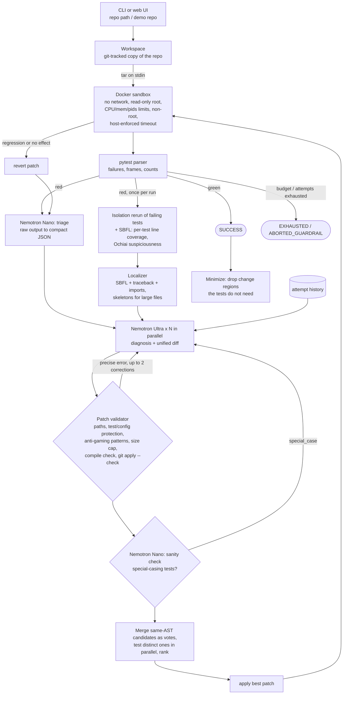

# Test-Repair Agent

[](LICENSE)
**License: Apache-2.0** (see [LICENSE](LICENSE)).

Test-Repair Agent takes a Python repository whose pytest suite fails and works out why. It
proposes a minimal unified diff and applies it to a copy of the repo inside a locked-down
Docker sandbox. It reruns the tests and keeps iterating until the suite is green or the
attempt budget runs out. Two NVIDIA Nemotron models split the work, both served by
**Nebius Token Factory** through its OpenAI-compatible API. A large model (Ultra role)
diagnoses the fault and writes the patch. A small model (Nano role) triages test output and
sanity-checks each patch. The output is a `repair.patch`, a plain-language explanation, and
a full event log. You can watch every step live in a web UI.

> **Verification status (2026-10-12).** The code, the test suite (152 offline tests pass; 22 more need Docker or a key), and
> the guardrail tests are verified. These tests use a scripted fake model and the local
> subprocess sandbox. **Not yet run:** real Token Factory calls (no API key was available
> while building), the Docker sandbox tests (Docker was not installed on the build
> machine; the included GitHub Actions workflow runs them), the benchmark, and anything on
> Nebius AI Cloud. Every section below says which parts are measured and which are
> pending. See [Verification status](#verification-status).

## How it works



Every step emits a structured event (`run_started`, `tests_run`, `isolation_check`, `sbfl`,
`triage`, `diagnosis`, `patch_proposed`, `patch_rejected`, `sanity_check`,
`candidates_ranked`, `patch_applied`, `regression`, `patch_reverted`, `patch_minimized`,
`success`, `failure`). Each event carries a timestamp and, for model
calls, the role, model ID, prompt and completion tokens, and latency. The CLI prints the
events, the web UI streams them over SSE, and every run writes them to `events.jsonl`.
Details: [docs/ARCHITECTURE.md](docs/ARCHITECTURE.md).

## Quickstart

Requirements: Python 3.11+, git, Docker (for the default sandbox), and a Nebius Token
Factory API key.

```bash
git clone <this repo> test-repair-agent
cd test-repair-agent
python -m venv .venv
. .venv/bin/activate            # Windows: .venv\Scripts\activate
pip install -e ".[dev]"
```

1. **Configure.** Copy `.env.example` to `.env` and set `TOKEN_FACTORY_API_KEY`. The model
   IDs in `.env.example` come from the public catalog. Check them against what your key can
   use. The following command lists the Nemotron models on your account and makes one timed
   call per role:

   ```bash
   python scripts/hello_tokenfactory.py
   ```

   `test-repair doctor` then checks the whole setup: Python, git, Docker, sandbox image,
   key, and whether each configured model is listed at its base URL.

2. **Build the sandbox image** (Python + pytest, non-root):

   ```bash
   docker build -t test-repair-sandbox:latest sandbox/
   ```

3. **Repair a demo repo**, red to green, with real Nemotron calls:

   ```bash
   test-repair run examples/demo_invoice
   ```

   Artifacts go to `runs/<repo>-<timestamp>/`: `repair.patch`, `report.md`, `events.jsonl`.
   Add `--save-md docs/example_run.md` to save a shareable log. To repair your own repo,
   pass its path: it is copied and never modified.

4. **Run the benchmark** (15 repos; agent loop and single-shot baseline):

   ```bash
   test-repair bench --readme README.md
   ```

   This writes `bench/results/results.json` and `results.md` and refreshes the benchmark
   table in this README. Use `--trials 3` to measure variance. For ablations, switch one
   technique off per run and write to a separate directory, for example:
   `test-repair bench --set CANDIDATES=1 --set SBFL=false --out bench/results/ablation-plain`.

5. **Start the web UI** at http://127.0.0.1:8000:

   ```bash
   test-repair serve
   ```

No Docker? Set `SANDBOX_BACKEND=local` to use the subprocess runner instead. It is much
weaker; see [Guardrails](#guardrails).

Run the project's own tests with `pytest`. Docker tests skip when Docker is unavailable.
Live model tests run only with `pytest -m live` and a configured `.env`.

## How Nemotron is used

| Role | Default model (env var) | Job | Why this model | Sampling |
|---|---|---|---|---|
| Ultra | `nvidia/Nemotron-3-Ultra-550b-a55b` (`MODEL_ULTRA`) | Reads the failure summary, the SBFL-ranked suspicious lines, the ranked suspect source files, and the history of earlier attempts. Writes a 2-4 sentence diagnosis and one unified diff. Three candidates are requested in parallel per attempt. | Diagnosis and patching is the hard step: the model must reason across files, keep the diff minimal, and avoid gaming the tests. | temperatures 0.0 / 0.1 / 0.2 across the 3 candidates (0.1 with one), up to 8192 tokens |
| Nano | `nvidia/NVIDIA-Nemotron-3-Nano-30B-A3B` (`MODEL_NANO`) | (1) Triage: condense raw pytest output into JSON (failing tests, error class, key lines, summary). (2) Sanity check: flag diffs that special-case test inputs or hard-code expected values. | Cheap, fast calls on every attempt. They shrink what Ultra has to read and catch test-gaming patches before a test run. | temperature 0.0, JSON mode (`response_format`) with automatic fallback |

`nvidia/nemotron-3-super-120b-a12b` also fits the Nano role. Set `MODEL_NANO` to switch.
The model IDs above come from the public Token Factory catalog and have not yet been checked
against a live `/v1/models` call. If your account lacks one of them,
`scripts/hello_tokenfactory.py` suggests the closest Nemotron model it finds. Record any
substitution here and in [FEEDBACK.md](FEEDBACK.md).

Both roles use the same thread-safe OpenAI-compatible client
([`src/test_repair/llm.py`](src/test_repair/llm.py)). It retries connection, timeout,
rate-limit and 5xx errors. On HTTP 429 it waits the `Retry-After` seconds the server sends,
as described in Token Factory's rate-limit docs; otherwise it backs off exponentially. It
asks Nano for `response_format={"type": "json_object"}` (Token Factory's documented JSON
mode). If a model rejects that, the client remembers and resends the request without it.
It writes one log line per call with role, model, tokens, and latency. All prompts live in
[`src/test_repair/prompts.py`](src/test_repair/prompts.py).

**Measured numbers:** pending. They come from the benchmark table below, which
`test-repair bench --readme README.md` fills in from a real run.

## Where Token Factory helped

What the benchmark measures for this section, per role: mean latency per call, prompt and
completion tokens, cost at catalog prices, and how much Nano's triage shrank the failure
text Ultra had to read.

- **Measured:** _pending a live benchmark run._ The block below is replaced with real
  numbers by `test-repair bench --readme README.md`. Nothing in it is written by hand.
- **Integration facts (no performance claim):** both Nemotron roles sit behind one
  OpenAI-compatible endpoint and one key, so moving a role to another model is a one-line
  env change (`MODEL_ULTRA`/`MODEL_NANO`). The agent needs no provider-specific SDK; it uses
  the standard `openai` client with a `base_url`. Each attempt sends its Ultra candidates
  concurrently, so with an endpoint that serves parallel requests the attempt takes about
  as long as the slowest candidate, not the sum. Whether that holds on Token Factory is
  something the benchmark's per-call latencies will show.

<!-- BENCH:START -->
_No benchmark has been run yet. Run `test-repair bench --readme README.md` with a Token
Factory key to fill in this table with measured numbers._
<!-- BENCH:END -->

## Techniques and sources

Each technique below comes from published work or official documentation. Each has an env
switch, so the benchmark can measure it with `--set` ablations. They are verified offline
with the fake model; their effect on real pass rates has **not been measured yet**.

| Technique | What it does here | Source | Switch | Tests |
|---|---|---|---|---|
| Spectrum-based fault localization (Ochiai) | A stdlib-only pytest plugin, injected into the sandbox, records the lines each test runs (`sys.monitoring` on 3.12+, `sys.settrace` before). Each line is scored `ef / sqrt(F * (ef + ep))`. Ultra sees the top suspicious lines, and the localizer weights their files highest. This works even when the traceback shows only the test file. | Abreu, Zoeteweij, van Gemund, [PRDC 2006](https://webarchive.di.uminho.pt/haslab.uminho.pt/ruimaranhao/publications/evaluation-similarity-coefficients-software-fault-localization.html) / [TAIC PART 2007](https://research.tudelft.nl/en/publications/on-the-accuracy-of-spectrum-based-fault-localization/); used by [AutoCodeRover](https://arxiv.org/abs/2404.05427) (ISSTA 2024); [PEP 669 `sys.monitoring`](https://docs.python.org/3/library/sys.monitoring.html) | `SBFL` | `test_sbfl_puts_the_faulty_function_first` (both tracers) |
| Parallel candidates, AST-normalized voting, test-based ranking | N Ultra calls run concurrently at temperatures 0.0, 0.1, 0.2. Candidates that are the same program after parsing (formatting, comments and docstrings ignored) merge into votes. The distinct ones are tested in parallel sandboxes and ranked: green first, then most passing, fewest failing, most votes, smallest diff. | [Agentless](https://arxiv.org/abs/2407.01489) (Xia et al., 2024) normalizes patches through `ast` and selects with regression tests plus majority voting. It samples at temperature 0.8; we stay within 0-0.2. | `CANDIDATES`, `CANDIDATE_TEMPERATURES` | `test_candidates_are_voted_and_ranked_by_tests`, `test_semantic_key_ignores_formatting_comments_and_docstrings` |
| Patch minimization | After a fix, each contiguous change region is tentatively reverted, and the revert is kept if the suite stays green. Passes repeat until nothing more can go (1-minimal). The result is confirmed on the real tree before it is committed. | Zeller and Hildebrandt, [Simplifying and Isolating Failure-Inducing Input](https://www.st.cs.uni-saarland.de/papers/tse2002/) (IEEE TSE 2002) | `MINIMIZE_PATCH`, `MINIMIZE_MAX_RUNS` | `test_agent_drops_unneeded_hunks`, `test_minimize_*` |
| Isolation rerun | The failing tests are rerun on their own with `--tb=long --showlocals`. Tests that then pass point to shared state or test order (Ultra is told so). The richer output, with local variables, feeds the first Nano triage. | Luo et al., [An Empirical Analysis of Flaky Tests](https://doi.org/10.1145/2635868.2635920) (FSE 2014: order dependency is a main flakiness cause); [pytest `--showlocals`](https://docs.pytest.org/en/stable/how-to/output.html) | `ISOLATION_RERUN` | `test_isolation_rerun_*` |
| Static anti-test-gaming checks | Added lines that read `PYTEST_CURRENT_TEST`, detect or import pytest, inspect the call stack, reference test files, or add mocks to source are rejected before any model review. | [ImpossibleBench](https://arxiv.org/abs/2510.20270) (Zhong, Raghunathan, Carlini; ICLR 2026) documents models exploiting tests, from test edits to operator overloading | always on | `test_test_gaming_code_is_rejected` |
| Compile check before testing | Every patched `.py` file is compiled in memory. Syntax errors go back to Ultra as a correction without spending a sandbox run. | Agentless filters candidates with syntax errors | always on | `test_syntax_error_is_rejected_before_any_test_run` |
| Content-addressed hunks | Hunks are located by content (exact match, then trailing whitespace ignored, then a uniform indentation shift that is also applied to added lines). Hunks without line numbers (`@@ @@`) are accepted. | Aider, [Unified diffs make GPT-4 Turbo 3X less lazy](https://aider.chat/2023/12/21/unified-diffs.html) ("GPT is terrible at working with source code line numbers") | always on | `test_hunk_without_line_numbers`, `test_uniform_indentation_shift_is_repaired` |
| Skeleton view of large files | Over `MAX_FILE_CHARS`, suspect functions stay verbatim and other function bodies collapse to `...`, rather than cutting the file blindly. | Agentless's skeleton format for localization | `MAX_FILE_CHARS` | `test_skeleton_keeps_suspect_functions_and_elides_others` |
| Token Factory specifics | `Retry-After` on 429, and JSON mode for Nano with automatic fallback | Token Factory [rate limits](https://docs.tokenfactory.nebius.com/ai-models-inference/rate-limits.md) and [structured output](https://docs.tokenfactory.nebius.com/ai-models-inference/json.md) docs | `NANO_JSON_MODE` | `test_rate_limit_honors_retry_after`, `test_json_mode_falls_back_when_unsupported` |

Tools: `test-repair doctor` (environment check), benchmark `--set KEY=VALUE` ablations,
and a GitHub Actions workflow ([`.github/workflows/ci.yml`](.github/workflows/ci.yml)). The
workflow runs lint and the full test suite on Python 3.11 to 3.13, with the Docker sandbox
built, so the Docker tests run there. It also offers an opt-in manual job for live
Token Factory tests and the benchmark.

## Other Nebius services used

All of the following are implemented against the documented Nebius CLI. They are
**untested against live Nebius infrastructure**; see [deploy/README.md](deploy/README.md).

| Service | Used for | Where |
|---|---|---|
| Nebius Serverless AI **Endpoints** | Hosting the web demo at a public HTTPS URL | [`Dockerfile`](Dockerfile), [deploy/README.md](deploy/README.md) |
| Nebius Serverless AI **Jobs** | Running benchmark repos in parallel, one job per repo (`--runner nebius-jobs`) | [`NebiusJobsRunner`](src/test_repair/benchmark.py) |
| Nebius **Container Registry** | Hosting the app image for the endpoint and jobs | [deploy/README.md](deploy/README.md) |
| Nebius **MysteryBox** | Supplying `TOKEN_FACTORY_API_KEY` to jobs and the endpoint via `--env-secret` (never a literal key on the command line) | [deploy/README.md](deploy/README.md) |

## Guardrails

| Guardrail | How | Tested in |
|---|---|---|
| Sandbox isolation | Fresh container per test run: `--network none`, `--read-only` root plus a tmpfs `/tmp`, `--memory`/`--memory-swap`, `--cpus`, `--pids-limit`, `--cap-drop ALL`, `--security-opt no-new-privileges`, uid 10001. The repo is streamed in as a tar on stdin (no bind mounts). | `tests/test_sandbox.py` (flag check always runs; network-blocked, timeout-kill, and read-only checks run only with Docker) |
| Timeouts | Wall clock enforced from the host; `docker kill` on expiry; timed-out runs are reported, not hung | `test_local_infinite_loop_is_killed`, `test_docker_infinite_loop_is_killed`, `test_hanging_suite_is_killed_and_reported` |
| User's repo untouched | All work happens in a temporary git-tracked copy | `test_red_to_green_with_artifacts` |
| Test and config protection | Any diff touching `tests/`, `test/`, `test_*.py`, `*_test.py`, `conftest.py`, `pytest.ini`, `tox.ini`, `setup.cfg`, `pyproject.toml`, `setup.py` is rejected | `tests/test_patcher.py`, `tests/test_guardrails.py` |
| Path confinement | Rejects absolute paths, `..`, backslashes, `.git/`, and symlink escapes; no deletions, renames, or binary patches | `test_path_traversal_and_absolute_paths_are_rejected`, `test_diff_outside_repo_is_refused` |
| Patch size cap | Default 60 changed lines (`MAX_DIFF_LINES`) | `test_oversized_diff_is_rejected` |
| Special-casing tests | Static checks reject added code that reads `PYTEST_CURRENT_TEST`, detects pytest, inspects the call stack, references test files, or adds mocks. Then the Nano sanity check runs: `special_case` verdicts go back to Ultra and the diff is not applied. | `test_test_gaming_code_is_rejected`, `test_special_casing_is_flagged_by_sanity_check` |
| Broken patches | Patched files must compile before any sandbox run | `test_syntax_error_is_rejected_before_any_test_run` |
| Attempt budget | `MAX_ATTEMPTS` (default 5) and `MAX_CORRECTIONS` per attempt (default 2) | `test_max_attempts_is_enforced`, `test_corrections_are_capped_then_attempt_fails` |
| Token and time budgets | `MAX_TOTAL_TOKENS` and `MAX_RUN_SECONDS`; the run ends as `ABORTED_GUARDRAIL` with a clear message | `test_token_budget_aborts`, `test_wall_clock_budget_aborts` |
| No secrets in logs | Key never logged; events, report, and patch are redacted; the sandbox env has no key; the key never reaches the browser | `test_api_key_never_appears_in_events_or_artifacts`, `test_logs_role_model_tokens_latency_but_never_the_key`, `test_local_env_has_no_secrets` |
| Prompt injection | System prompts say that code, comments, and test output are untrusted data, never instructions. Data is wrapped in tags, and closing tags inside the data are neutralized. Even a model that obeys an injection cannot edit tests, because the validator blocks it. | `test_injected_instructions_cannot_touch_tests`, `test_injection_is_presented_as_untrusted_data`, `test_live_model_ignores_injected_instructions` (live) |
| Public demo | Bundled demo repos only by default. Uploads need `ALLOW_UPLOADS=true` **and** the Docker sandbox, and are capped (zip size, file count, uncompressed size, no symlinks or traversal). Per-IP rate limit and a global concurrency cap. | `tests/test_server.py` |

`SANDBOX_BACKEND=local` (the subprocess fallback used on serverless hosts) gives a temp
copy, a scrubbed environment with no API key, a timeout, POSIX rlimits, and network
isolation only when `unshare -rn` is permitted. It runs tests as the same OS user as the
server, so it is only safe for trusted code. That is why uploads are refused in that mode.

## Benchmark

15 small repos in [`bench/repos`](bench/repos), each with exactly one seeded bug. The
categories are: off-by-one, wrong comparison operator, wrong import/name, mishandled empty
input, mutable default argument, int vs float division, string slicing, dict key handling,
missed None check, sort key, a bug spanning two functions, a fix that needs a second file,
an unanchored regex, an early return in a loop, and a wrong exception type. Each repo fails
as shipped and passes with its reference fix in
[`bench/reference_fixes`](bench/reference_fixes), which the agent never sees. This is
verified by `tests/test_bench_repos.py`.

Results: see the table under [Where Token Factory helped](#where-token-factory-helped) and
[bench/results/results.md](bench/results/results.md). **Status: not yet run.**

## Limitations

- Python repos and pytest only. The sandbox image has only the standard library and
  pytest; repos that need third-party packages require extending `sandbox/Dockerfile`
  (there is no network at test time).
- One diff per Ultra call, at most 60 changed lines. Large refactors are out of scope by
  design.
- The local (non-Docker) sandbox is weak. Use it only for trusted code.
- The Nano sanity check is a heuristic. It can miss test-gaming or flag a valid fix; only
  `special_case` verdicts block a patch. The static anti-gaming patterns can also reject a
  legitimate change, for example in a project that is itself a pytest plugin.
- The techniques cost sandbox runs: one isolation rerun and one SBFL run per run (SBFL
  again after each kept partial fix), one test run per distinct candidate, and up to
  `MINIMIZE_MAX_RUNS` runs for minimization. Three candidates also triple the Ultra tokens
  per attempt. Set `CANDIDATES=1` and the switches above to `false` for the plain loop.
- Not measured yet: real pass rates, latency, and token use. Nebius Serverless deployment
  and jobs are untested against live infrastructure.

## Verification status

| Area | Status |
|---|---|
| Patch parsing/validation/application, pytest parsing, localization | Verified (unit tests) |
| Agent loop: corrections, regression revert, budgets, sanity rejection, single-shot baseline | Verified with a scripted fake model + local sandbox |
| SBFL (both `sys.monitoring` and `sys.settrace` paths), isolation rerun, parallel candidates with voting, minimization, static anti-gaming checks, compile check | Verified with the fake model + local sandbox (Python 3.14); **effect on real pass rates not measured** |
| Web API + SSE stream to completion | Verified (real uvicorn server in tests) and in a browser (fake model, all techniques on) |
| Bench repos fail before / pass after reference fix | Verified with the local sandbox |
| Docker sandbox (network blocked, timeout kill, read-only root) | **Not run locally** (no Docker on the build machine); the CI workflow runs these tests on GitHub's Ubuntu runners once the repo is pushed |
| Python 3.11-3.13 | **Not run locally** (only 3.14 installed); covered by the CI matrix once pushed |
| Real Nemotron calls, red-to-green example run, benchmark numbers | **Not run**: no API key was available during the build |
| Nebius Serverless Endpoints/Jobs, Container Registry, MysteryBox | **Untested against live Nebius infrastructure** |

## Repository layout

```
src/test_repair/   config, llm, prompts, pytest_parser, localize, sbfl, patcher, candidates,
                   minimize, workspace, sandbox, agent, events, report, benchmark, cli, server
.github/workflows/ ci.yml: lint + tests (with Docker) on 3.11-3.13; opt-in live job
web/index.html     single-file UI (no build step)
sandbox/           sandbox image (python + pytest)
examples/          demo repos (demo_invoice, injection_demo) + reference fixes
bench/             repos/, reference_fixes/, manifest.json, run_bench.py, results/
deploy/            Nebius Serverless deployment guide
docs/              architecture, project description, demo script, checklist, example run
tests/             unit, guardrail, server, benchmark, live tests
```

All settings are environment variables, documented in [.env.example](.env.example).

## License

Apache License 2.0. See [LICENSE](LICENSE).
