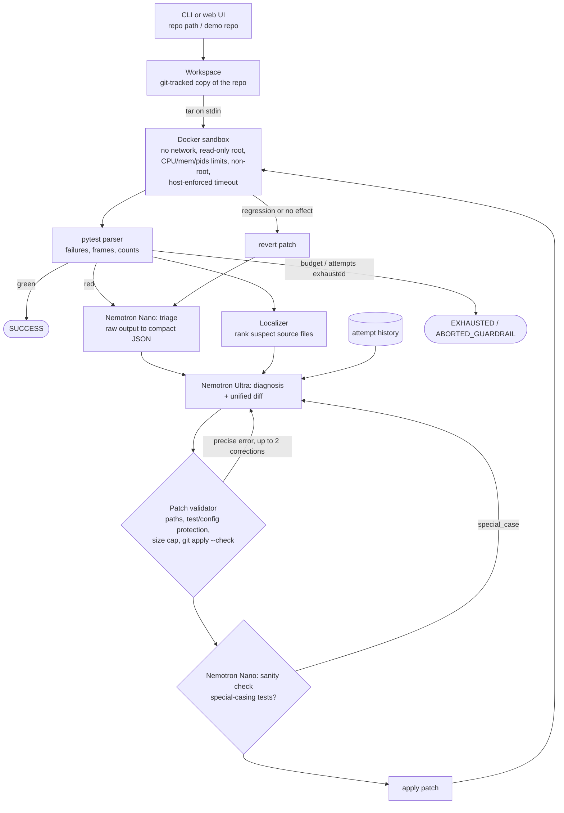

# Test-Repair Agent

[](LICENSE)
**License: Apache-2.0** (see [LICENSE](LICENSE)).

Test-Repair Agent takes a Python repository whose pytest suite fails and works out why. It
proposes a minimal unified diff and applies it to a copy of the repo inside a locked-down
Docker sandbox. It reruns the tests and keeps iterating until the suite is green or the
attempt budget runs out. Two NVIDIA Nemotron models split the work, both served by
**Nebius Token Factory** through its OpenAI-compatible API. A large model (Ultra role)
diagnoses the fault and writes the patch. A small model (Nano role) triages test output and
sanity-checks each patch. The output is a `repair.patch`, a plain-language explanation, and
a full event log. You can watch every step live in a web UI.

> **Verification status (2026-10-12).** The code, the 120 offline tests, and the guardrail
> tests are verified. These tests use a scripted fake model and the local subprocess
> sandbox. **Not yet run:** real Token Factory calls (no API key was available while
> building), the Docker sandbox tests (Docker was not installed on the build machine), the
> benchmark, and anything on Nebius AI Cloud. Every section below says which parts are
> measured and which are pending. See [Verification status](#verification-status).

## How it works



Every step emits a structured event (`run_started`, `tests_run`, `triage`, `diagnosis`,
`patch_proposed`, `patch_rejected`, `sanity_check`, `patch_applied`, `regression`,
`patch_reverted`, `success`, `failure`). Each event carries a timestamp and, for model
calls, the role, model ID, prompt and completion tokens, and latency. The CLI prints the
events, the web UI streams them over SSE, and every run writes them to `events.jsonl`.
Details: [docs/ARCHITECTURE.md](docs/ARCHITECTURE.md).

## Quickstart

Requirements: Python 3.11+, git, Docker (for the default sandbox), and a Nebius Token
Factory API key.

```bash
git clone <this repo> test-repair-agent
cd test-repair-agent
python -m venv .venv
. .venv/bin/activate            # Windows: .venv\Scripts\activate
pip install -e ".[dev]"
```

1. **Configure.** Copy `.env.example` to `.env` and set `TOKEN_FACTORY_API_KEY`. The model
   IDs in `.env.example` come from the public catalog. Check them against what your key can
   use. The following command lists the Nemotron models on your account and makes one timed
   call per role:

   ```bash
   python scripts/hello_tokenfactory.py
   ```

2. **Build the sandbox image** (Python + pytest, non-root):

   ```bash
   docker build -t test-repair-sandbox:latest sandbox/
   ```

3. **Repair a demo repo**, red to green, with real Nemotron calls:

   ```bash
   test-repair run examples/demo_invoice
   ```

   Artifacts go to `runs/<repo>-<timestamp>/`: `repair.patch`, `report.md`, `events.jsonl`.
   Add `--save-md docs/example_run.md` to save a shareable log. To repair your own repo,
   pass its path: it is copied and never modified.

4. **Run the benchmark** (15 repos; agent loop and single-shot baseline):

   ```bash
   test-repair bench --readme README.md
   ```

   This writes `bench/results/results.json` and `results.md` and refreshes the benchmark
   table in this README. Use `--trials 3` to measure variance.

5. **Start the web UI** at http://127.0.0.1:8000:

   ```bash
   test-repair serve
   ```

No Docker? Set `SANDBOX_BACKEND=local` to use the subprocess runner instead. It is much
weaker; see [Guardrails](#guardrails).

Run the project's own tests with `pytest`. Docker tests skip when Docker is unavailable.
Live model tests run only with `pytest -m live` and a configured `.env`.

## How Nemotron is used

| Role | Default model (env var) | Job | Why this model | Sampling |
|---|---|---|---|---|
| Ultra | `nvidia/Nemotron-3-Ultra-550b-a55b` (`MODEL_ULTRA`) | Reads the failure summary, the ranked suspect source files, and the history of earlier attempts. Writes a 2-4 sentence diagnosis and one unified diff. | Diagnosis and patching is the hard step: the model must reason across files, keep the diff minimal, and avoid gaming the tests. | temperature 0.1, up to 8192 tokens |
| Nano | `nvidia/NVIDIA-Nemotron-3-Nano-30B-A3B` (`MODEL_NANO`) | (1) Triage: condense raw pytest output into JSON (failing tests, error class, key lines, summary). (2) Sanity check: flag diffs that special-case test inputs or hard-code expected values. | Cheap, fast calls on every attempt. They shrink what Ultra has to read and catch test-gaming patches before a test run. | temperature 0.0 |

`nvidia/nemotron-3-super-120b-a12b` also fits the Nano role. Set `MODEL_NANO` to switch.
The model IDs above come from the public Token Factory catalog and have not yet been checked
against a live `/v1/models` call. If your account lacks one of them,
`scripts/hello_tokenfactory.py` suggests the closest Nemotron model it finds. Record any
substitution here and in [FEEDBACK.md](FEEDBACK.md).

Both roles use the same OpenAI-compatible client ([`src/test_repair/llm.py`](src/test_repair/llm.py)):
retries with exponential backoff on connection, timeout, rate-limit and 5xx errors, and one
log line per call with role, model, tokens, and latency. All prompts live in
[`src/test_repair/prompts.py`](src/test_repair/prompts.py).

**Measured numbers:** pending. They come from the benchmark table below, which
`test-repair bench --readme README.md` fills in from a real run.

## Where Token Factory helped

What the benchmark measures for this section, per role: mean latency per call, prompt and
completion tokens, cost at catalog prices, and how much Nano's triage shrank the failure
text Ultra had to read.

- **Measured:** _pending a live benchmark run._ The block below is replaced with real
  numbers by `test-repair bench --readme README.md`. Nothing in it is written by hand.
- **Integration facts (no performance claim):** both Nemotron roles sit behind one
  OpenAI-compatible endpoint and one key, so moving a role to another model is a one-line
  env change (`MODEL_ULTRA`/`MODEL_NANO`). The agent needs no provider-specific SDK; it uses
  the standard `openai` client with a `base_url`.

<!-- BENCH:START -->
_No benchmark has been run yet. Run `test-repair bench --readme README.md` with a Token
Factory key to fill in this table with measured numbers._
<!-- BENCH:END -->

## Other Nebius services used

All of the following are implemented against the documented Nebius CLI. They are
**untested against live Nebius infrastructure**; see [deploy/README.md](deploy/README.md).

| Service | Used for | Where |
|---|---|---|
| Nebius Serverless AI **Endpoints** | Hosting the web demo at a public HTTPS URL | [`Dockerfile`](Dockerfile), [deploy/README.md](deploy/README.md) |
| Nebius Serverless AI **Jobs** | Running benchmark repos in parallel, one job per repo (`--runner nebius-jobs`) | [`NebiusJobsRunner`](src/test_repair/benchmark.py) |
| Nebius **Container Registry** | Hosting the app image for the endpoint and jobs | [deploy/README.md](deploy/README.md) |
| Nebius **MysteryBox** | Supplying `TOKEN_FACTORY_API_KEY` to jobs and the endpoint via `--env-secret` (never a literal key on the command line) | [deploy/README.md](deploy/README.md) |

## Guardrails

| Guardrail | How | Tested in |
|---|---|---|
| Sandbox isolation | Fresh container per test run: `--network none`, `--read-only` root plus a tmpfs `/tmp`, `--memory`/`--memory-swap`, `--cpus`, `--pids-limit`, `--cap-drop ALL`, `--security-opt no-new-privileges`, uid 10001. The repo is streamed in as a tar on stdin (no bind mounts). | `tests/test_sandbox.py` (flag check always runs; network-blocked, timeout-kill, and read-only checks run only with Docker) |
| Timeouts | Wall clock enforced from the host; `docker kill` on expiry; timed-out runs are reported, not hung | `test_local_infinite_loop_is_killed`, `test_docker_infinite_loop_is_killed`, `test_hanging_suite_is_killed_and_reported` |
| User's repo untouched | All work happens in a temporary git-tracked copy | `test_red_to_green_with_artifacts` |
| Test and config protection | Any diff touching `tests/`, `test/`, `test_*.py`, `*_test.py`, `conftest.py`, `pytest.ini`, `tox.ini`, `setup.cfg`, `pyproject.toml`, `setup.py` is rejected | `tests/test_patcher.py`, `tests/test_guardrails.py` |
| Path confinement | Rejects absolute paths, `..`, backslashes, `.git/`, and symlink escapes; no deletions, renames, or binary patches | `test_path_traversal_and_absolute_paths_are_rejected`, `test_diff_outside_repo_is_refused` |
| Patch size cap | Default 60 changed lines (`MAX_DIFF_LINES`) | `test_oversized_diff_is_rejected` |
| Special-casing tests | Nano sanity check; `special_case` verdicts are sent back to Ultra and the diff is not applied | `test_special_casing_is_flagged_by_sanity_check` |
| Attempt budget | `MAX_ATTEMPTS` (default 5) and `MAX_CORRECTIONS` per attempt (default 2) | `test_max_attempts_is_enforced`, `test_corrections_are_capped_then_attempt_fails` |
| Token and time budgets | `MAX_TOTAL_TOKENS` and `MAX_RUN_SECONDS`; the run ends as `ABORTED_GUARDRAIL` with a clear message | `test_token_budget_aborts`, `test_wall_clock_budget_aborts` |
| No secrets in logs | Key never logged; events, report, and patch are redacted; the sandbox env has no key; the key never reaches the browser | `test_api_key_never_appears_in_events_or_artifacts`, `test_logs_role_model_tokens_latency_but_never_the_key`, `test_local_env_has_no_secrets` |
| Prompt injection | System prompts say that code, comments, and test output are untrusted data, never instructions. Data is wrapped in tags, and closing tags inside the data are neutralized. Even a model that obeys an injection cannot edit tests, because the validator blocks it. | `test_injected_instructions_cannot_touch_tests`, `test_injection_is_presented_as_untrusted_data`, `test_live_model_ignores_injected_instructions` (live) |
| Public demo | Bundled demo repos only by default. Uploads need `ALLOW_UPLOADS=true` **and** the Docker sandbox, and are capped (zip size, file count, uncompressed size, no symlinks or traversal). Per-IP rate limit and a global concurrency cap. | `tests/test_server.py` |

`SANDBOX_BACKEND=local` (the subprocess fallback used on serverless hosts) gives a temp
copy, a scrubbed environment with no API key, a timeout, POSIX rlimits, and network
isolation only when `unshare -rn` is permitted. It runs tests as the same OS user as the
server, so it is only safe for trusted code. That is why uploads are refused in that mode.

## Benchmark

15 small repos in [`bench/repos`](bench/repos), each with exactly one seeded bug. The
categories are: off-by-one, wrong comparison operator, wrong import/name, mishandled empty
input, mutable default argument, int vs float division, string slicing, dict key handling,
missed None check, sort key, a bug spanning two functions, a fix that needs a second file,
an unanchored regex, an early return in a loop, and a wrong exception type. Each repo fails
as shipped and passes with its reference fix in
[`bench/reference_fixes`](bench/reference_fixes), which the agent never sees. This is
verified by `tests/test_bench_repos.py`.

Results: see the table under [Where Token Factory helped](#where-token-factory-helped) and
[bench/results/results.md](bench/results/results.md). **Status: not yet run.**

## Limitations

- Python repos and pytest only. The sandbox image has only the standard library and
  pytest; repos that need third-party packages require extending `sandbox/Dockerfile`
  (there is no network at test time).
- One diff per Ultra call, at most 60 changed lines. Large refactors are out of scope by
  design.
- The local (non-Docker) sandbox is weak. Use it only for trusted code.
- The Nano sanity check is a heuristic. It can miss test-gaming or flag a valid fix; only
  `special_case` verdicts block a patch.
- Not measured yet: real pass rates, latency, and token use. Nebius Serverless deployment
  and jobs are untested against live infrastructure.

## Verification status

| Area | Status |
|---|---|
| Patch parsing/validation/application, pytest parsing, localization | Verified (unit tests) |
| Agent loop: corrections, regression revert, budgets, sanity rejection, single-shot baseline | Verified with a scripted fake model + local sandbox |
| Web API + SSE stream to completion | Verified (real uvicorn server in tests) and in a browser (fake model) |
| Bench repos fail before / pass after reference fix | Verified with the local sandbox |
| Docker sandbox (network blocked, timeout kill, read-only root) | **Not run**: Docker was not installed on the build machine |
| Real Nemotron calls, red-to-green example run, benchmark numbers | **Not run**: no API key was available during the build |
| Nebius Serverless Endpoints/Jobs, Container Registry, MysteryBox | **Untested against live Nebius infrastructure** |

## Repository layout

```
src/test_repair/   config, llm, prompts, pytest_parser, localize, patcher, workspace,
                   sandbox, agent, events, report, benchmark, cli, server
web/index.html     single-file UI (no build step)
sandbox/           sandbox image (python + pytest)
examples/          demo repos (demo_invoice, injection_demo) + reference fixes
bench/             repos/, reference_fixes/, manifest.json, run_bench.py, results/
deploy/            Nebius Serverless deployment guide
docs/              architecture, project description, demo script, checklist, example run
tests/             unit, guardrail, server, benchmark, live tests
```

All settings are environment variables, documented in [.env.example](.env.example).

## License

Apache License 2.0. See [LICENSE](LICENSE).
